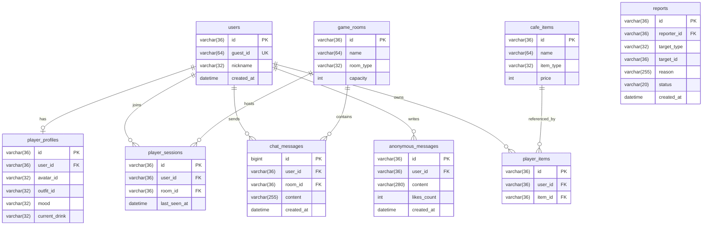

# 24h Café – Thiết kế Cơ sở Dữ liệu & Lưu trữ (Database Specification)

## 1. Kiến trúc Lưu trữ Kết hợp (MySQL + In-Memory/Redis)
- **MySQL**: Lưu trữ dữ liệu bền vững (người dùng, hồ sơ nhân vật, danh sách phòng cố định, lời nhắn ẩn danh, vật phẩm, báo cáo vi phạm và lịch sử chat cần kiểm duyệt).
- **Redis / Server Memory**: Lưu trữ trạng thái thời gian thực tần suất cao:
  - Vị trí tọa độ `(x, y)`, hướng nhìn (`direction`), trạng thái hoạt ảnh (`idle`, `walk`, `sit`, `drink`).
  - Bản đồ ghế đang có người ngồi (`seatId -> userId`) trong từng phòng.
  - Bộ đếm giới hạn tốc độ gửi tin nhắn (Rate limiting) và di chuyển.

---

## 2. Sơ đồ Thực thể Quan hệ (ER Diagram)



---

## 3. DDL SQL Chuẩn (MySQL 8.0+)

```sql
CREATE TABLE users (
  id VARCHAR(36) PRIMARY KEY,
  guest_id VARCHAR(64) NOT NULL UNIQUE,
  nickname VARCHAR(32) NOT NULL,
  created_at TIMESTAMP DEFAULT CURRENT_TIMESTAMP
);

CREATE TABLE player_profiles (
  id VARCHAR(36) PRIMARY KEY,
  user_id VARCHAR(36) NOT NULL UNIQUE,
  avatar_id VARCHAR(32) NOT NULL DEFAULT 'preset_01',
  outfit_id VARCHAR(32) NOT NULL DEFAULT 'casual_latte',
  mood VARCHAR(32) NOT NULL DEFAULT 'peaceful',
   updated_at TIMESTAMP DEFAULT CURRENT_TIMESTAMP ON UPDATE CURRENT_TIMESTAMP,
  CONSTRAINT fk_profile_user FOREIGN KEY (user_id) REFERENCES users(id) ON DELETE CASCADE
);

CREATE TABLE game_rooms (
  id VARCHAR(36) PRIMARY KEY,
  name VARCHAR(64) NOT NULL,
  room_type VARCHAR(32) NOT NULL DEFAULT 'main',
  capacity INT NOT NULL DEFAULT 25
);

CREATE TABLE player_sessions (
  id VARCHAR(36) PRIMARY KEY,
  user_id VARCHAR(36) NOT NULL,
  room_id VARCHAR(36) NOT NULL,
  last_seen_at TIMESTAMP DEFAULT CURRENT_TIMESTAMP,
  INDEX idx_room_last_seen (room_id, last_seen_at)
);

CREATE TABLE chat_messages (
  id BIGINT AUTO_INCREMENT PRIMARY KEY,
  user_id VARCHAR(36) NOT NULL,
  room_id VARCHAR(36) NOT NULL,
  content VARCHAR(255) NOT NULL,
  created_at TIMESTAMP DEFAULT CURRENT_TIMESTAMP,
  INDEX idx_room_created (room_id, created_at)
);

CREATE TABLE cafe_items (
  id VARCHAR(36) PRIMARY KEY,
  name VARCHAR(64) NOT NULL,
  item_type ENUM('drink', 'outfit', 'decor') NOT NULL,
  price INT NOT NULL DEFAULT 0,
  icon VARCHAR(16) NOT NULL DEFAULT '☕'
);

CREATE TABLE player_items (
  id VARCHAR(36) PRIMARY KEY,
  user_id VARCHAR(36) NOT NULL,
  item_id VARCHAR(36) NOT NULL,
  UNIQUE KEY uk_user_item (user_id, item_id)
);

CREATE TABLE anonymous_messages (
  id VARCHAR(36) PRIMARY KEY,
  user_id VARCHAR(36) NOT NULL,
  content VARCHAR(280) NOT NULL,
  likes INT NOT NULL DEFAULT 0,
  created_at TIMESTAMP DEFAULT CURRENT_TIMESTAMP,
  INDEX idx_created_at (created_at DESC)
);

CREATE TABLE reports (
  id VARCHAR(36) PRIMARY KEY,
  reporter_id VARCHAR(36) NOT NULL,
  target_type ENUM('user', 'chat', 'anonymous_message') NOT NULL,
  target_id VARCHAR(36) NOT NULL,
  reason VARCHAR(255) NOT NULL,
  status ENUM('pending', 'reviewed', 'resolved') NOT NULL DEFAULT 'pending',
  created_at TIMESTAMP DEFAULT CURRENT_TIMESTAMP
);
```

